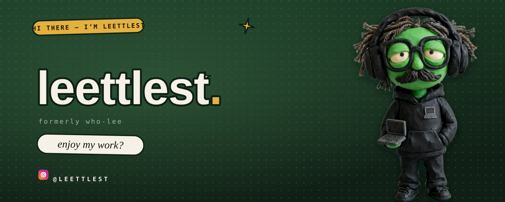

<!--
  GitHub PROFILE README
  github.com/<you>/<you>/README.md
  Commit these together — every src is relative:
    hero-pop.svg (the whole poster; clicking it opens instagram @leettlest)
  GitHub-safe HTML only — no scripts, no stylesheets. The poster carries
  its own background, so it sits correctly on github light and dark themes.
-->

  

